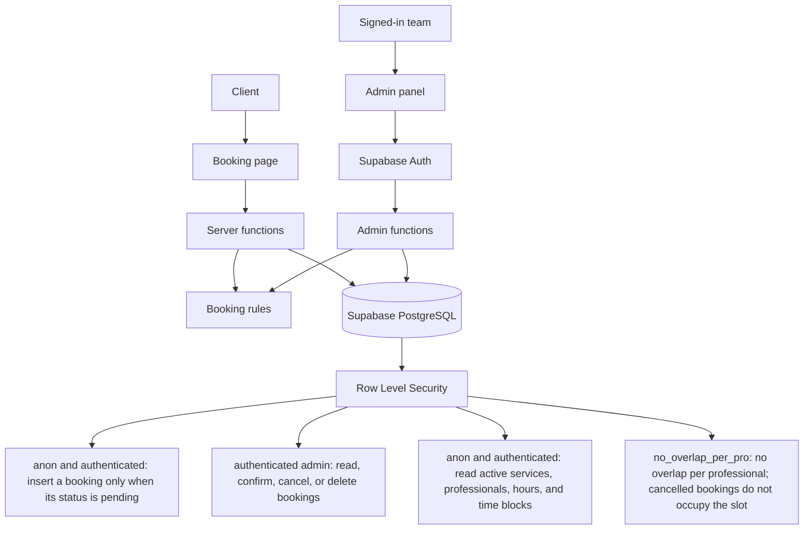

# Salon Booking System

Website and **online booking system** for a hair salon, built as a full-stack demo.
Clients pick a service, a professional, a day and a time; the team manages everything from a
private admin panel.

> **Demo content:** "Studio Demo" is a fictional business. All names, addresses, phone numbers,
> texts and images are placeholders.

> Screenshots / GIF: _add 2–3 images here (booking flow + admin panel)._

## Features

- **Step-by-step booking:** service → professional (or "no preference") → date → time → contact details
- **Server-side availability** computed from working hours, time blocks (holidays, days off) and
  existing bookings, in 30-minute slots
- **No double bookings:** enforced by the database with an exclusion constraint
  (`btree_gist` + `tstzrange`)
- **Admin panel** behind sign-in: confirm or cancel bookings, manage services, professionals,
  working hours and time blocks
- **Row Level Security:** the public can only create `pending` bookings; only admins can read
  customer data
- **Input validation** with Zod in TanStack Start server functions
- Per-page SEO (title, description, Open Graph) and a generated `sitemap.xml`

## Tech stack

| Layer | Technology |
|---|---|
| Front-end | React 19, TypeScript, Tailwind CSS 4, shadcn/ui |
| Framework | TanStack Start / TanStack Router (SSR + server functions) |
| Database & auth | Supabase (PostgreSQL, Auth, Row Level Security) |
| Tooling | Vite, ESLint, Prettier, GitHub Actions |

## Data model

```
services ─────────┐
                  ├── bookings (starts_at, ends_at, status, customer details)
professionals ────┤
                  ├── working_hours (weekday, open_time, close_time)
                  └── time_blocks (days off / holidays; NULL professional = whole salon)
user_roles (admin) ── has_role() used by the RLS policies
```

SQL migrations (schema, policies and fictional seed data) are in
[`supabase/migrations/`](supabase/migrations).

## Architecture

A booking crosses three layers. The front end (the public page and the admin panel) calls TanStack
Start server functions. Those functions validate the input, read and write Supabase, and apply the
pure scheduling rules in `src/lib/booking-rules.ts`: the service interval, 30-minute slots,
overlap, professional choice, and what cancellation does. Supabase enforces access with Row Level
Security and rejects two active bookings for the same professional.



A booking follows these steps:

1. The client chooses a service, a professional (or no preference), a day, and a time.
2. `getAvailability` builds the slots from working hours, time blocks, and bookings that are not cancelled.
3. `createBooking` rejects a time in the past, assigns the first free professional when there is no preference, and stores the booking as `pending`.
4. An admin confirms or cancels it. A cancelled booking no longer occupies the slot.

## Getting started

Requirements: Node.js 20+ and a Supabase project.

```bash
git clone https://github.com/ottonielmorais2008-rgb/salon-booking-system.git
cd salon-booking-system
npm ci
cp .env.example .env   # fill in your Supabase URL and publishable (anon) key
npm run dev
```

Apply the migrations with the [Supabase CLI](https://supabase.com/docs/guides/cli):
`supabase link --project-ref <your-project-ref>` and then `supabase db push`.

## Scripts

| Command | What it does |
|---|---|
| `npm run dev` | Start the dev server |
| `npm run lint` | ESLint + Prettier checks |
| `npm run test` | Unit tests for the booking rules |
| `npm run format` | Format the code with Prettier |
| `npm run build` | Production build |

## Tests

The unit tests cover the booking rules. They do not need Supabase or a browser.

```bash
npm test
```

The command runs Vitest once (`vitest run`) on `src/lib/booking-rules.test.ts`. Continuous
integration runs the same command after lint and the production build.

CI (GitHub Actions) runs `npm ci`, lint, build and `npm test` on every push and pull request.

## Known issues / roadmap

- **Availability does not see existing bookings.** `getAvailability` reads `bookings` with the
  public (anon) client, but RLS only lets admins read that table, so every slot looks free and a
  conflict is only caught at the end by the exclusion constraint. Planned fix: a
  `SECURITY DEFINER` SQL function that returns only busy intervals (no personal data).
- **Time zone handling.** Times are stored as Lisbon wall-clock values with a `Z` suffix
  (`wallClockISO`). It works for a single salon but is not real UTC. Planned fix: convert
  Europe/Lisbon ↔ UTC explicitly.
- **First sign-up becomes admin.** The `handle_new_user` trigger promotes the first user to admin.
  Disable public sign-ups in Supabase Auth or create the admin manually before going live.
- **Professional ↔ service mapping** is not modelled yet: auto-assignment may pick a professional
  who does not offer that service.
- Some admin and booking handlers still use `any` (reported as lint warnings).
- Slot, overlap and cancellation rules are covered by `npm test`. The availability query still
  cannot see existing bookings under the current RLS policies (see below).

## What went wrong

These are problems found while checking the booking path against the schema, the policies and CI.
The list above is what is still open. Each note below is how it showed up, and what changed or is
still planned.

**The calendar could not see bookings.** `getAvailability` (and the "no preference" picker in
`createBooking`) reads `bookings` with the public anon client. `SELECT` is granted only to
`authenticated`, and the RLS policy allows it only when `has_role(..., 'admin')` is true. The
handler keeps `data` and ignores `error`, so a denied read becomes an empty list. Past times
and public `time_blocks` still close a slot; existing bookings do not. The overlapping insert is
still rejected: `no_overlap_per_pro` (`btree_gist` + `tstzrange`) raises `23P01`, and
`createBooking` maps that to "This time slot was just taken." Planned fix: a `SECURITY DEFINER`
function that returns busy intervals and no customer fields.

**Salon times were stored with a UTC label.** `wallClockISO` appends `:00.000Z` to the chosen
date and time. The comment in `src/lib/booking.functions.ts` treats that string as Europe/Lisbon
wall-clock, shared by client and server for one salon. Lisbon is never converted to UTC, so the
stored instant is the wall-clock value with a `Z` suffix. Planned fix: convert Europe/Lisbon and
UTC explicitly.

**The first sign-up became admin.** `handle_new_user` inserts an `admin` role when `user_roles`
has no admin yet. A follow-up migration hardened the functions around it: `touch_updated_at` now
sets `search_path`, `EXECUTE` on `handle_new_user` and `touch_updated_at` is revoked from
`PUBLIC`, `anon` and `authenticated`, `has_role` is revoked from `PUBLIC` and `anon` and granted
to `authenticated`, and `btree_gist` was moved into the `extensions` schema. The trigger is unchanged. Before a real
launch, public sign-up has to be disabled in Supabase Auth, or the admin created by hand.

**"No preference" ignores which services a person offers.** There is no table linking
`professionals` to `services`. Auto-assignment walks that day's `working_hours` and takes the
first professional whose hours cover the slot. The booking read has the same anon/RLS gap, so the
check that actually runs is hours plus public time blocks. The chosen person may not offer that
service. A mapping is still to be added.

**Handlers stayed loosely typed.** `assertAdmin` takes `supabase: any`, and the admin and booking
screens type their rows as `any`. ESLint keeps `@typescript-eslint/no-explicit-any` at `warn`
until those handlers use the generated Supabase types. The overlap rules now live in
`src/lib/booking-rules.ts` and are covered by `npm test`; CI runs that step after lint and build.

## How it was built

The first version was generated with Lovable (AI-assisted development) and the build still uses
the `@lovable.dev/vite-tanstack-config` Vite preset. This repository is a cleaned-up, white-label
version: fictional brand and placeholder images, environment-based configuration, documented
known issues and CI.

## License

Code under the [MIT License](LICENSE). "Studio Demo" and all demo content are fictional.
